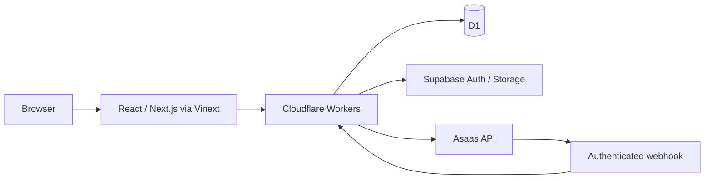

# Engineering quality / Qualidade de engenharia

Owner and maintainer: João Victor da Silva (JustJao1).

## Architecture / Arquitetura

ADR-001: Use D1 for application records and Supabase for identity. Do not infer identity from display name or email. ADR-002: Payment entitlement depends on server-confirmed settlement. No real checkout in automated browser tests. ADR-003: Keep Secure cookies in production; authenticated test flows need a dedicated HTTPS sandbox and test identity.

## Run / Executar
Node 24: npm ci; npm run db:local; npm run typecheck; npm test; npm run build. For browser tests: npm install --prefix tests/browser; npx --prefix tests/browser playwright install chromium; npm --prefix tests/browser test.
Docker Compose provides a local public/demo environment: docker compose up --build --wait; open http://127.0.0.1:4173. No production secrets or remote migrations. Authentication and payment are not configured by this container. Stop with docker compose down.

## Actual evidence / Evidências reais
[Engineering quality workflow](https://github.com/JustJao1/meu-ritmo/actions/workflows/engineering-quality.yml) generates browser HTML/JUnit and core coverage logs. Browser suite covers public landing, responsive viewport, login form, simulated rejection, simulated recovery, signup validation and private route redirect. Mocked API responses are not provider integration tests. Existing deploy and production monitoring workflows remain unchanged. Real account creation, task/finance CRUD, email delivery, CAPTCHA, provider checkout and authenticated permissions require an isolated HTTPS test environment. Do not label them E2E-verified from this suite. Coverage output includes only code exercised by the existing Node test runner; inspect scope before quoting percentages.

## Technical demo (EN)
Show public landing and sign-in forms, then describe the calendar, finances, shared spaces and Pix entitlement lifecycle. Demonstrate with a test account only in an approved environment. Explain how Worker routes validate the session and persist records in D1. Show CI logs and limitations; never display private data, tokens or payment credentials.

## Demonstração (PT)
Apresente a página inicial e os formulários, depois agenda, finanças e espaços compartilhados com conta de teste autorizada. Explique a validação de sessão, persistência em D1 e conciliação Pix. Mostre os logs reais de CI e as limitações.

## AI-assisted review
Review diffs and dependencies, verify authorization boundaries and input validation, run typecheck/test/build, inspect browser and CI artifacts before merge. Never provide real secrets or customer records to AI tools. This is the review procedure, not a claim about every historical commit.
